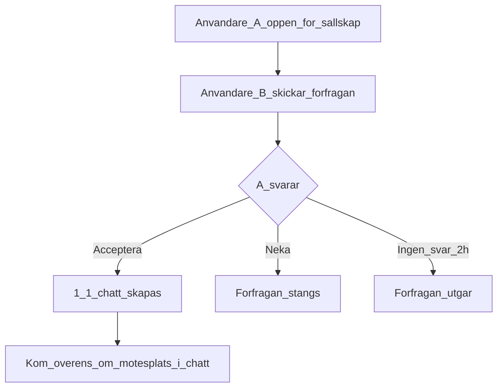

# MVP-zoner, synlighet, expire och fiskesällskap

**Beslutat 2026-11-06** (Etapp 0). Gäller tills något annat dokumenteras i `mvp-omfattning.md`.

## Geografisk avgränsning (MVP)

- **Inne:** Malmö innerkanal innanför Turbinbron, Neptunibron och Suellsbron (+ närmaste kajsträckor som hör till samma fiskesystem).
- **Utanför MVP-start:** Västra hamnen i stort, öppet hav, dammar, Ribersborg (kan visas som regelinfo men inte som socialt primärt område).

## Sociala fiskzoner (namn)

Zoner är grova namngivna områden – **inte** exakta spöplatser. Användare syns i zonen, inte på kajmetern.

| id | Visningsnamn | Ungefärligt område |
| --- | --- | --- |
| `slottsparken` | Slottsparken | Kajer vid Slottsparken / kanalens västra parksträcka |
| `kungsparken` | Kungsparken | Kajer vid Kungsparken |
| `malmohus` | Malmöhus (utanför vallgrav) | Område nära Malmöhus **utanför** förbjuden vallgrav |
| `centralen` | Centralen / station | Kanalsträcka kring centralstationsområdet |
| `davidshall` | Davidshall | Södra kanalarmen kring Davidshall |
| `triangeln_soder` | Södra kanalen | Södra sträckan mot Triangeln/Amiralsbron |
| `neptuni` | Neptuni / inre hamnkant | Närmast Neptunibron (innanför tillåten gräns) |
| `suell` | Suell / östra inner | Närmast Suellsbron (innanför tillåten gräns) |

GeoJSON med ungefärliga polygoner: [data/sociala-zoner.geojson](../data/sociala-zoner.geojson).

---

## Synlighetslägen

| Läge | Syns på kartan? | Mottaglig för sällskap? | Default |
| --- | --- | --- | --- |
| **Ghost Mode** | Nej | Nej (utom om användaren aktivt aktiverar “öppen via zonlista” – se nedan) | Av |
| **Zon-läge** | Ja, som zon-pin/etikett (t.ex. “Slottsparken”) | Endast om flaggan **Öppen för fiskesällskap** är på | **Ja – default när man syns** |
| **Exakt punkt** | Ja, ungefärlig punkt (avsiktligt avrundad, t.ex. ~50–80 m) | Endast om “Öppen för fiskesällskap” är på | **Nej – alltid manuellt opt-in** |

### Beslutade defaults

1. Default när man “checkar in”: **Zon-läge**, inte exakt punkt.
2. **Öppen för fiskesällskap** är en **separat** toggle (default **av**). Att synas ≠ att vilja bli kontaktad.
3. Ghost Mode döljer kartmarkering helt. Användaren kan fortfarande **brows:a** öppna sällskap i en zonlista.
4. Exakt punkt kräver extra bekräftelse: “Din position blir mer detaljerad. Du kan byta till zon eller ghost när som helst.”
5. Fångstrapporter defaultar till **zon** (inte exakt spot).

### Ghost + sällskap

**Beslut:** “Öppen för fiskesällskap” kräver **inte** synlig kartmarkering.  
Ghost-användare ska kunna synas i **zonlista** som “Någon i Slottsparken – öppen för sällskap” utan kartpin, om de valt zon + öppen-flagga. De syns **inte** med nick på kartan.

**Nuläge i appen:** Ghost + **öppen för sällskap** + zon publicerar en `fishing_sessions`-rad utan koordinater. Syns i **Ute**-listan och under **Sällskap**, men inte som kartnål. Ghost utan sällskapsflagga publicerar ingen rad.

---

## Expire och heartbeat

| Status | Standardvaraktighet | Max | Heartbeat / förlängning |
| --- | --- | --- | --- |
| Fiskar nu | **4 timmar** | **6 timmar** | “Jag är kvar” förlänger +30 min, max upp till 6 h; 2 h-nudge + varning före expire |
| Planerar pass | Till angiven sluttid | **10 timmar** framåt | Ingen heartbeat; döljs vid sluttid |
| Manuell | — | — | **Dölj nu / Avsluta** alltid synlig |
| Efter expire | Markering bort från karta inom ~1 min (server cron/poll) | — | Historik sparas privat enligt retention |

Server litar inte enbart på klienten: `expires_at` cap:as i DB-trigger (`sanitize_fishing_session`, max 6 h) och publika koordinater avrundas (~60 m) / zon-skrivs om mot `canal_spots`.

---

## Fiskesällskap – kontaktflöde

### Regler

- Ingen publik telefon, e-post eller sociala handles.
- Förfrågan innehåller: kort text (max ~200 tecken), föreslagen tid, valfri zon för möte.
- Efter accept: 1:1-tråd; endast de två (+ moderator vid report).
- Rate limit: max **5** utgående förfrågningar / timme; max **1** aktiv “fiskar nu”-markering per konto.
- Block: dolda för varandra (status, förfrågan, chatt).
- Report: skäl (spam, olämpligt, misstänkt otrygghet) → kö för dig som moderator.
- Minimiålder MVP: **16+** (strängare default; kan sänkas senare med vårdnadshavare).

### Mötesplats utan att avslöja hemlig spot

Chatten föreslår **offentliga mötespunkter** (brofäste, parkentré, café) – inte “min exakta abborreplats”. Användaren väljer själv hur mycket de delar i chatten.

---

## Datamodell (utkast för Etapp 1)

Se [data-modell.md](data-modell.md).

## Integritet

Se [integritetspolicy-utkast.md](integritetspolicy-utkast.md).
